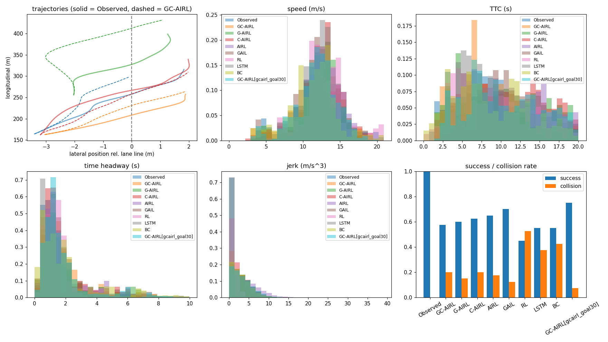
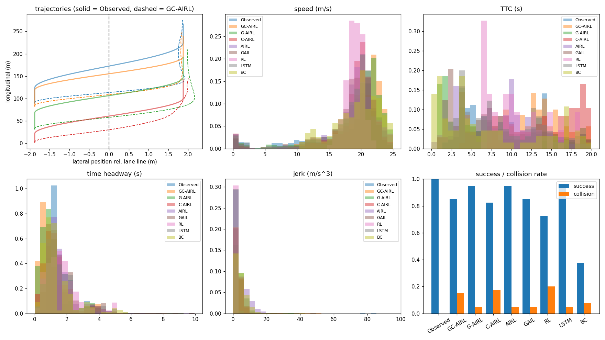

# GC-AIRL 匝道汇入行为复现

非官方复现：Jie Sun, Hai Yang (2024). **Learning two-dimensional merging behaviour from vehicle trajectories with imitation learning.** *Transportation Research Part C* 160, 104530. [doi:10.1016/j.trc.2024.104530](https://doi.org/10.1016/j.trc.2024.104530)

论文从 NGSIM 真实轨迹中学习匝道汇入车辆的二维（纵向 + 横向）驾驶行为。在 AIRL 的基础上加入两种机制，提出 **GC-AIRL**：
- **目标条件（goal-conditioned）**：把目的地 g 拼进状态，并在车辆越过车道线 1 m 时给予额外奖励；
- **置信度加权（confidence-aware）**：每条专家轨迹分配一个置信度 β，用轨迹排序损失做双层优化，降低次优人类示范的影响。

## 实现内容

| 模型 | 说明 | 代码 |
|---|---|---|
| **GC-AIRL** | 论文主模型 | `mergeil/adversarial.py` (`gcairl`) |
| G-AIRL / C-AIRL | 消融（论文表 3） | `gairl` / `cairl` |
| AIRL | 基线 | `airl` |
| GAIL | 基线，奖励 log D | `gail` |
| RL | 基线，手工奖励（论文 Eq.20）+ PPO | `rl` |
| LSTM | 基线，2 层 256，dropout 0.2，MSE，RMSprop | `mergeil/lstm.py` |
| BC | 额外基线（论文没有） | `mergeil/bc.py` |

论文与代码的对应关系：

| 论文 | 代码 |
|---|---|
| 3.1 状态（16 维：ego + l/p/f 三辆车）、动作（ax, ay）、Eq.1 欧拉更新 | `mergeil/env.py` |
| 3.3.1 生成器：高斯策略 + 价值网络，2×128 tanh，PPO-clip ε=0.2 | `mergeil/policy.py`, `mergeil/ppo.py` |
| 3.3.2 判别器：f = c(s,a,g) + γh(s′) − h(s)，c、h 均 2×64；奖励 r = c + r_goal | `mergeil/adversarial.py` |
| 3.3.3 置信度估计器：排序损失 RK（Eq.10），双层优化（Eq.11–13） | `mergeil/adversarial.py` |
| 4.2 数据处理：Kalman 滤波、lane 6→5、换道前后各 2 s | `mergeil/data/ngsim.py`, `mergeil/scenes.py` |
| 5.1 指标：成功率、平均速度、速度标准差、TTC、车头时距、碰撞率、jerk；排序得分 | `mergeil/metrics.py` |

## 运行

依赖：`numpy pandas scipy torch matplotlib`（`pip install -r requirements.txt`）。网络很小，CPU 即可。

```bash
# 1. 数据
#    --path 可以是解压出的 trajectories-*.csv / .txt 所在目录，也可以是合并版 CSV
python scripts/prepare_data.py --source ngsim --path <US-101 轨迹目录> --locations us-101 --out outputs/scenes.pkl
python scripts/prepare_data.py --source ngsim --path <I-80 轨迹目录> --locations i-80 --all-test --out outputs/i80.pkl
#    没有数据时可先用合成数据跑通流程：
python scripts/prepare_data.py --source synthetic

# 2. 训练（每个模型一条命令）
python scripts/train.py --model gcairl
python scripts/train.py --model airl     # gairl / cairl / gail / rl / lstm / bc 同理

# 3. 评估：论文表 2（US-101 测试集）和表 4（I-80 迁移性）
python scripts/evaluate.py --models outputs/gcairl/best.pt outputs/airl/best.pt outputs/gail/best.pt outputs/rl/best.pt outputs/lstm/best.pt
python scripts/evaluate.py --scenes outputs/i80.pkl --models outputs/gcairl/best.pt ...
```

超参数在 `mergeil/config.py`，可以写一个 JSON 只覆盖部分字段（如 `{"adv": {"iterations": 1000}}`），再用 `--config` 传入。

## 数据

论文只用了 NGSIM：US-101 共 164 条汇入轨迹（124 训练 / 40 测试），I-80 共 139 条（每次随机抽 40 条做迁移性测试）。
NGSIM 是公开数据，数据不随仓库分发。两种获取方式都支持：
- 各地点的数据包，如 `US-101-LosAngeles-CA.zip`：解压其中的 `us-101-vehicle-trajectory-data.zip`，得到 3 个时段的 `trajectories-*.csv`（或 `.txt`）；
- data.transportation.gov 上 “Next Generation Simulation (NGSIM) Vehicle Trajectories” 的合并版 CSV（含 Location 列）。

US-101 的数据检查（3 个时段，共 4824 辆车）：
- 有 6→5 换道的车辆共 282 辆，几乎全部从匝道（lane 7）进入，按车道序列分：7→6→5 有 131 辆，7→6→5→4… 有 128 辆，其余为来回换道等；
- 按本仓库的规则提取到 260 个场景（剔除 3 个专家轨迹与他车重叠的、12 个专家始终没越过车道线 1 m 的），比论文的 164 条多。论文没有说明额外的筛选条件，这里保留全部；
- 回放专家轨迹：成功率 1.0，碰撞率 0，测试集平均速度 11.7 m/s（论文 12.0），换道前后横向位置约为两条车道中心（车道线两侧各约 1.8 m）。

处理中发现并修正的两个问题（第一版提取中约 9% 的专家轨迹按论文标准“没有成功”）：
- 车道中心沿纵向漂移约 ±0.5 m，而车道线被当作直线。现在按目标车道中心线把道路“拉直”（`common.straighten_lanes`）；
- 拥堵中常见“并一下、停一下再并”，横向速度也很慢，单靠速度阈值会把换道结束点判得过早。现在允许 1 s 内的停顿，并要求结束点至少越过车道线 1.5 m（最多到越线后 8 s）。

## 与论文的差异和假设

论文没有给出的细节，这里按下表处理。都可以在 `config.py` 中调整：

| 项目 | 论文 | 本仓库 |
|---|---|---|
| US-101 汇入场景数 | 164（124 训练 / 40 测试） | 260（208 训练 / 12 验证 / 40 测试），见“数据”一节 |
| 换道起止点检测 | 小波变换 | 横向速度阈值（0.1 m/s），允许 1 s 停顿，结束点至少越线 1.5 m |
| 车道线 | 未说明 | 按目标车道中心线拉直道路后取一条直线 |
| RL 奖励（Eq.20）各项权重 | 未给出 | 各项权重为 1；目标项横向按车道宽缩放（在 1/2/3 个车道宽和路面宽中按验证集选出） |
| RL 安全项的 TTC 对象 | 未说明 | 当前车道前车；车身离车道线不到 1.5 m 时也算目标车道前后车，取最小（按验证集选出） |
| Kalman 滤波参数 | 未给出 | 常加速度模型，参数见 `ngsim.py` 的 `KALMAN` |
| I-80 车道 | 论文写 lane 6→5 | 照论文；NGSIM 官方说明中 I-80 的 lane 7 才是匝道，可通过 `lane_maps` 改为 7→6 |
| 优势估计 | k 步回报 | GAE（λ=0.95） |
| 置信度粒度、外层学习率 | 未给出 | 每条专家轨迹一个 β = n·softmax(θ)，内外层学习率见配置 |
| TTC / 车头时距的统计范围 | 未说明 | 只统计 (0, 20] s 和 (0, 10] s（与论文图 6 的横轴一致） |
| 训练迭代次数、批大小 | 未给出 | 500 轮 × 4096 步 |
| 输入归一化 | 位置 [0,1]，其他 [-1,1] | 按专家数据做 z-score |
| 模型选择 | 未说明 | 从训练集留出 12 条做验证集，按“成功率 − 碰撞率”选最优 |
| 状态中的纵向位置 | 绝对位置 | 绝对位置（NGSIM Local_Y），横向位置相对车道线 |

| 训练时的碰撞处理 | 未说明 | 对抗式模型：碰撞后进入吸收态直到专家轨迹结束；RL：碰撞即结束回合（见下文调试记录） |

扩展（论文没有，默认关闭）：`env.reactive=True` 时，ego 正后方的回放车会改用 IDM 跟驰。

## 目录

```
mergeil/
  data/        数据适配器：ngsim（论文用）、highd、synthetic（调试用）
  scenes.py    汇入场景提取与划分
  env.py       回放环境、状态构造
  ppo.py       PPO
  adversarial.py  GAIL / AIRL / G-AIRL / C-AIRL / GC-AIRL / RL
  lstm.py, bc.py  监督学习基线
  metrics.py, evaluate.py  论文指标与评估
scripts/       prepare_data / train / evaluate
```

## 结果

### NGSIM US-101（论文表 2、表 3）

40 个测试场景，每个模型评估 5 次（随机采样动作）取平均；3 个训练随机种子（0/1/2，数据划分相同），表中为均值 ± 标准差。最后一列为论文的数值：

| 模型 | 成功率 | 平均速度 (m/s) | 速度标准差 (m/s) | TTC (s) | 车头时距 (s) | 碰撞率 | 纵向 jerk (m/s³) | 论文：成功率 / 碰撞率 |
|---|---|---|---|---|---|---|---|---|
| Observed | 1.000 | 11.72 | 1.19 | 10.47 | 1.61 | 0.000 | 0.43 | 1 / 0 |
| GC-AIRL | 0.715 ± 0.045 | 11.80 ± 0.21 | 1.14 ± 0.20 | 11.24 ± 0.70 | 1.52 ± 0.08 | 0.112 ± 0.051 | 3.48 ± 1.19 | 0.815 / 0.030 |
| G-AIRL | 0.697 ± 0.048 | 12.19 ± 0.16 | 1.03 ± 0.10 | 12.11 ± 0.39 | 1.64 ± 0.11 | 0.130 ± 0.033 | 2.61 ± 0.38 | 0.776 / 0.161 |
| C-AIRL | 0.672 ± 0.062 | 12.19 ± 0.47 | 1.09 ± 0.00 | 11.34 ± 0.81 | 1.52 ± 0.05 | 0.148 ± 0.032 | 3.36 ± 0.98 | 0.739 / 0.206 |
| AIRL | 0.767 ± 0.015 | 11.68 ± 0.24 | 1.15 ± 0.14 | 12.01 ± 1.01 | 1.56 ± 0.12 | 0.120 ± 0.035 | 3.26 ± 0.39 | 0.680 / 0.151 |
| GAIL | 0.557 ± 0.066 | 12.53 ± 0.36 | 1.11 ± 0.02 | 12.23 ± 0.46 | 1.73 ± 0.26 | 0.142 ± 0.015 | 3.32 ± 0.10 | 0.646 / 0.163 |
| RL | 0.692 ± 0.058 | 12.21 ± 0.21 | 0.76 ± 0.06 | 11.39 ± 0.35 | 1.46 ± 0.10 | 0.292 ± 0.029 | 0.80 ± 0.19 | 0.768 / 0.125 |
| LSTM | 0.750 ± 0.025 | 12.15 ± 0.25 | 1.21 ± 0.14 | 11.24 ± 0.25 | 1.77 ± 0.07 | 0.233 ± 0.029 | 0.40 ± 0.02 | 0.796 / 0.147 |
| BC | 0.612 ± 0.031 | 12.01 ± 0.61 | 1.46 ± 0.05 | 9.55 ± 0.94 | 1.85 ± 0.12 | 0.328 ± 0.003 | 2.71 ± 0.21 | — |

论文 Observed 行：平均速度 12.04，速度标准差 2.09，TTC 7.43，车头时距 2.48，jerk 0.82。

用策略均值评估（`--deterministic`）时成功率和碰撞率基本不变（GC-AIRL 0.733 / 0.100，AIRL 0.775 / 0.108），jerk 降到 0.1–0.5，与论文同一量级，说明论文很可能用确定性动作或较小的动作噪声评估。逐种子结果：`python scripts/summarize_seeds.py outputs/ngsim/eval/table.json outputs/ngsim/seed1/eval/table.json outputs/ngsim/seed2/eval/table.json`。



结论：
- 复现出的：成功率整体范围（0.56–0.77，论文 0.65–0.82）；消融的顺序 GC-AIRL > G-AIRL > C-AIRL；GAIL 明显不如 AIRL；
- **没有复现出的：GC-AIRL 优于 AIRL**。GC-AIRL 0.715 ± 0.045，AIRL 0.767 ± 0.015，在 3 个种子中有 2 个 AIRL 更高。两者碰撞率相近（约 0.11–0.12），远高于论文中 GC-AIRL 的 0.03。和论文相比，主要差别是我们的 AIRL 基线强得多（0.77 对 0.68），而不是 GC-AIRL 弱很多；
- RL 基线的成功率接近论文（0.69 对 0.77），但碰撞率仍偏高（0.29 对 0.125），见下文诊断；
- 标准差只反映训练随机性，不含测试集抽样的波动（测试集 40 条，±1 条就是 2.5 个百分点）。

### 诊断：为什么 GC-AIRL 没有超过 AIRL

检查了 GC-AIRL 两个机制在训练中的实际作用：
- **目标奖励几乎被淹没**：判别器奖励 c 约为每步 −2.7（一个回合约 −300），越线奖励只有一次 +1；PPO 会把优势标准化，起作用的是相对大小，所以“目标条件”实际上只剩把目标放进状态这一点；
- **置信度 β 比较集中**：训练结束时 β 在 0.1–17 之间，按权重算的有效专家轨迹数只有 60–90 / 208。β 和排序得分正相关（Spearman 0.4–0.6），说明方向是对的，但也和轨迹长度相关（约 0.3），因为排序比较的是整条轨迹的折扣回报之和。

对照实验（都是 GC-AIRL，3 个种子，配置在 `configs/`）：

| 变体 | 改动 | 成功率（按验证集选的检查点） | 成功率（最后一轮） | 碰撞率（最后一轮） |
|---|---|---|---|---|
| 论文设定 | — | 0.715 ± 0.045 | 0.717 ± 0.043 | 0.088 ± 0.012 |
| `goal30` | 目标奖励 1 → 30 | 0.747 ± 0.012 | **0.765 ± 0.030** | 0.113 ± 0.013 |
| `beta_slow` | β 学习率 1e-2 → 1e-3（β 接近均匀，有效轨迹数约 202） | 0.595 ± 0.026 | — | — |
| `goal30_beta_slow` | 两者都改 | 0.710 ± 0.039 | — | — |
| AIRL（对照） | — | 0.767 ± 0.015 | 0.753 ± 0.008 | 0.097 ± 0.028 |

结论：
- 把目标奖励调大后，GC-AIRL 稳定提升，和 AIRL 打平（最后一轮 0.765 对 0.753），但仍没有达到论文中领先 AIRL 约 0.13 的幅度；
- 让 β 变平反而更差，说明 β 的集中本身不是问题，置信度加权在一定程度上起了作用；
- 按 12 条验证集选检查点和直接用最后一轮的结果差别不大，排序结论不变；
- 这两个参数论文要么给了（目标奖励 1），要么没给（β 学习率），所以 `goal30` 只能算复现中发现的敏感参数，不是论文设定。论文中 c 的量级未知，目标奖励 1 在论文的奖励尺度下可能并不小。

### 诊断：RL 基线为什么偏弱

RL 的碰撞率约 0.37（论文 0.125），测试集上 16 次碰撞中有 12 次是并道时与目标车道车辆的侧向剐蹭。
Eq.20 的结构（效率 + 安全 + 舒适 + 目标）和论文一致，但论文没有给各项权重。按专家轨迹算，目标项的横向距离按车道宽缩放时，
并道前约为 −1.5/步，比效率加安全（约 +1.4）还大，所以车辆会抢着并道。试了把目标项的横向缩放调大（目标项变弱），3 个种子：

| 目标项横向缩放 | 验证集最优（成功率 − 碰撞率） | 测试集成功率 | 测试集碰撞率 |
|---|---|---|---|
| 1 个车道宽 3.66 m（默认） | **0.47** | 0.497 ± 0.060 | 0.367 ± 0.051 |
| 2 个车道宽 7.3 m（`configs/rl_y2lanes.json`） | 0.25 | 0.182 ± 0.134 | 0.192 |
| 3 个车道宽 11 m（`configs/rl_y3lanes.json`） | 0.25 | 0.155 ± 0.061 | 0.227 |
| 整个路面宽 21.9 m（纵向也按全路段 595 m） | 0.14 | 0.067 ± 0.040 | 0.235 ± 0.056 |

目标项一减弱，车辆就基本不并道，碰撞也没少多少，所以目标项保留按车道宽缩放。

真正的问题在安全项：原来只看当前车道的前车，而并道时最危险的是目标车道的车辆。改为车身离车道线不到 1.5 m 时，
同时计算目标车道前车 p 和后车 f 的 TTC，取三者最小（并排时记为 0）。对人类轨迹几乎不改变奖励（平均 0.728 → 0.717），3 个种子：

| 安全项 | 验证集最优（成功率 − 碰撞率） | 测试集成功率 | 测试集碰撞率 |
|---|---|---|---|
| 只看当前车道前车（`configs/rl_leader_safety.json`） | 0.47 | 0.497 ± 0.060 | 0.367 ± 0.051 |
| 并道时也看目标车道前后车（默认） | **0.56** | **0.692 ± 0.058** | **0.292 ± 0.029** |

按验证集选用后者，上面主表中的 RL 即为此设置。成功率已接近论文（0.768），碰撞率仍是论文的两倍多；
可能还与训练中动作噪声收缩过快（log std 约 −2.4）、探索不足有关。

失败案例分析（GC-AIRL，3 次 × 40 条）：碰撞中约 80% 是并道过程中与目标车道车辆的侧向剐蹭，约一半是 ego 并入后被回放的后车追尾（回放车辆不会避让）；未成功又未碰撞的多数是始终没有换道。把专家动作加上小噪声回放（ax 标准差 0.2 m/s²），成功率仍有 0.95，说明场景本身有一定余量，差距主要在学到的策略上。

### 合成数据（只用于验证代码）

合成数据由 IDM 加间隙接受规则生成，137 个汇入场景（85 训练 / 12 验证 / 40 测试），每个模型在测试集上评估 5 次取平均：

| 模型 | 成功率 | 平均速度 (m/s) | 速度标准差 (m/s) | TTC (s) | 车头时距 (s) | 碰撞率 | 纵向 jerk (m/s³) |
|---|---|---|---|---|---|---|---|
| Observed | 1.000 | 18.01 | 1.76 | 10.67 | 1.71 | 0.000 | 0.88 |
| GC-AIRL | 0.850 | 21.27 | 1.89 | 12.09 | 1.07 | 0.150 | 2.87 |
| G-AIRL | 0.935 | 19.71 | 1.78 | 10.08 | 1.24 | 0.050 | 3.73 |
| C-AIRL | 0.825 | 20.03 | 1.52 | 15.04 | 1.50 | 0.175 | 2.84 |
| AIRL | 0.930 | 19.01 | 1.56 | 8.67 | 1.52 | 0.060 | 5.53 |
| GAIL | 0.850 | 18.14 | 1.44 | 8.77 | 1.61 | 0.050 | 2.72 |
| RL | 0.725 | 18.98 | 0.55 | 10.65 | 1.82 | 0.200 | 0.39 |
| LSTM | 0.950 | 18.33 | 1.38 | 9.45 | 1.77 | 0.050 | 0.67 |
| BC | 0.405 | 19.71 | 1.68 | 9.11 | 1.49 | 0.080 | 4.16 |



这些数字**不能和论文比较**：
- 合成的“专家”全部出自同一个规则模型，不存在论文要解决的次优示范，所以置信度机制（C）在这里没有用武之地；
- 场景少（测试 40 条），差距在几个百分点以内的排名不可靠；
- 随机策略评估时 jerk 主要来自动作采样噪声，偏高。

### 调试记录：碰撞处理与归一化

论文没有说明训练时如何处理碰撞。下面三个问题都会让模型学会撞车，记录在此：

| 问题 | 现象 | 处理 |
|---|---|---|
| 生存偏置：AIRL/GAIL 的奖励大多为负，碰撞立即结束回合反而能少拿负奖励 | AIRL 训练碰撞率 89% | 训练时回合长度固定，碰撞不提前结束 |
| 碰撞没有代价：固定长度后，车辆重叠还能继续行驶 | GC-AIRL 并道后追尾前车，平均速度 23.5 m/s（真实 18.0） | 碰撞后进入吸收态（观测恒为 0，参考 DAC, Kostrikov et al. 2019），由判别器学出碰撞的代价 |
| 归一化爆炸：目标横向位置近似常数，标准差下限 1e-3 把吸收态的 0 放大到约 −1900 | 带目标条件的模型成功率只有 14–49% | 标准差过小的特征不做缩放 |

另外做了一个对照：把目标从判别器输入中去掉（`adv.disc_goal=false`），结果和论文设定相近（成功率 0.855 对 0.845），所以默认保留论文设定。
